# Habla Fluido — inglés con tutor de IA, voz y repetición espaciada (TDD)

App para practicar inglés todos los días: **pronunciación** (shadowing con reconocimiento de voz), **oído** (dictado),
**lectura**, **escritura** corregida y **conversación** con un tutor, más **repetición espaciada SM-2** y un **plan
diario** que da más minutos a la habilidad más débil. Construida con **TDD** siguiendo el *Manual paso a paso con
TDD — Habla Fluido*: alineación palabra por palabra (como el diff de Git) con Levenshtein, SM-2, promedio móvil,
método del mayor resto, y la IA detrás de un **proxy** que guarda la llave y el prompt (nunca en el APK).

**Retos del manual incluidos:** `frasesConfundidas` (pares como ship/sheep) y frases y una lectura sobre Dolores Hidalgo.

---

## 📦 APK

| Archivo | Ruta |
|---|---|
| Lista para instalar | `apk/HablaFluido.apk` (17.1 MB) |
| Salida de Flutter | `build/app/outputs/flutter-apk/app-release.apk` |

```bash
flutter build apk --release --target-platform android-arm64
```

El APK es para teléfonos **arm64** (prácticamente todos los Android de los últimos años). Para instalar: copia el `.apk` al teléfono, ábrelo y acepta *instalar apps de origen desconocido*.

Permiso que pide la app: **micrófono** (al tocar *Repetir* o 🎤). El reconocimiento de voz lo hace el servicio del
teléfono (Google) y puede necesitar internet y los datos de voz en inglés.

Este APK usa el **tutor simulado** (reglas, sin internet ni costo). Para el tutor con IA real, arranca el proxy con tu
llave y compila con `--dart-define=TUTOR_URL=https://tu-servidor/tutor`.

---

## 🏗️ Estructura

```
habla_fluido/
├── lib/dominio/       reglas · nivel · excepciones · comparador (Levenshtein + alineación) · repaso (SM-2)
│                      progreso (EMA, racha, nivel) · plan_diario · frase · lectura · tutor · voz · almacen
├── lib/datos/         tutor_simulado · tutor_http · voz_real · voz_simulada · almacen_avance
├── lib/presentacion/  vm/ (aprendizaje, pronunciación, dictado, lectura, escritura, conversación, repaso) · pantallas/
├── proxy/             prompt.js · server.js · test/proxy.test.js   (Node: la llave de la IA vive AQUÍ)
└── test/              comparador · repaso_progreso · tutor · vms
```

---

## 🖥️ Servidor

El **proxy** protege la llave de la IA y el prompt pedagógico. Sus pruebas usan un modelo falso (sin internet ni costo):

```bash
cd proxy
node --test
```

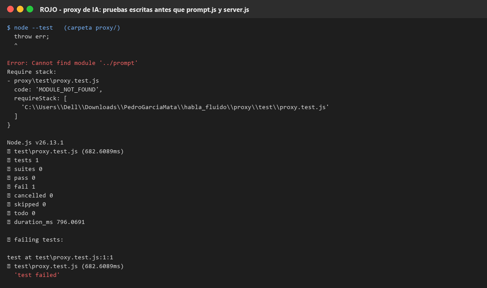

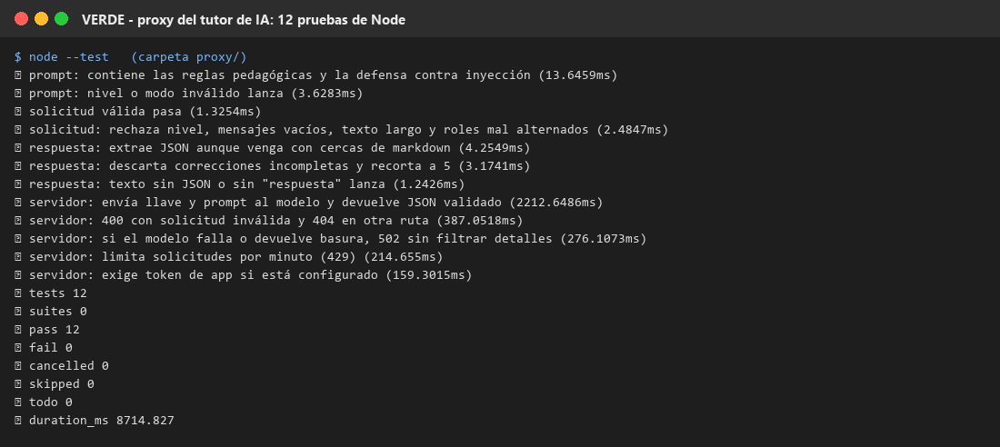

Para usar la IA real: `ANTHROPIC_API_KEY=tu_llave node server.js` (opcionales: `APP_TOKEN`, `MODEL`, `UPSTREAM_URL`).

---

## 🔴🟢🔵 Evidencia del ciclo TDD

### 1. 🔴 ROJO — las pruebas se escriben primero y fallan

Las pruebas de `test/` se escribieron **antes** que el código. Al correr `flutter test` con `lib/` todavía vacía, nada compila:

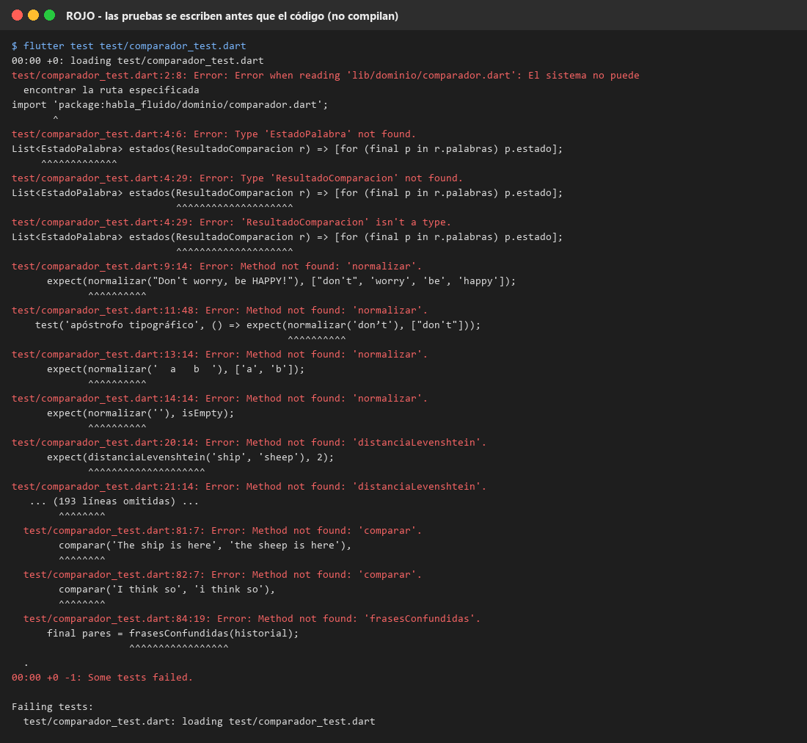

### 2. ❌ Error real atrapado por una prueba

El PDF del manual muestra `normalizar` así:

```dart
.replaceAll(''', "'")      // el carácter ’ (apóstrofo tipográfico) se perdió al exportar el PDF
```

Copiado tal cual no compila, y si se quita esa línea, el teléfono (que escribe `don’t` con apóstrofo tipográfico)
rompe la comparación: la prueba *"apóstrofo tipográfico"* esperaba `["don't"]` y obtuvo `['don', 't']`:

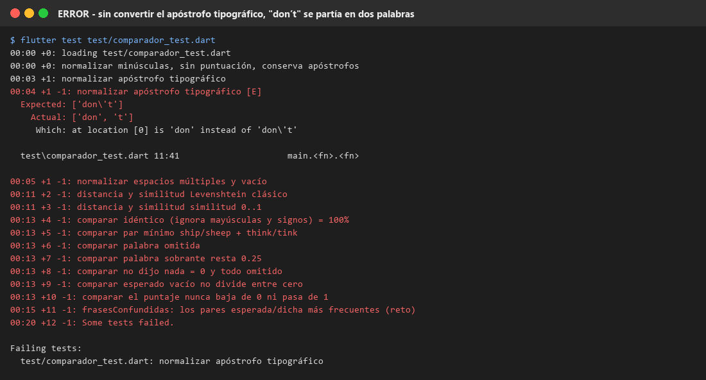

**Corrección:** convertir explícitamente el apóstrofo tipográfico (U+2019) al normal antes de separar palabras:

```dart
.replaceAll('’', "'")   // ✅ don’t → don't
```

### 3. 🔵 REFACTOR — limpiar sin romper nada

`flutter analyze` señaló avisos de estilo:

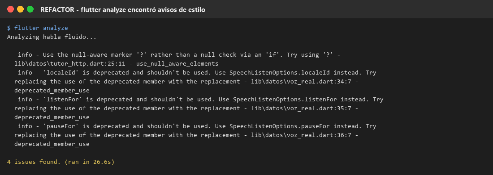

Se corrigieron y se volvió a analizar:

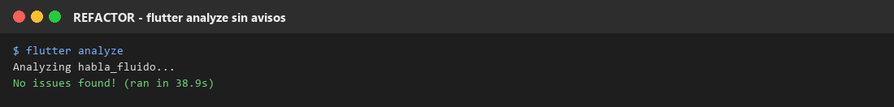

### 4. 🟢 VERDE — las 79 pruebas pasan

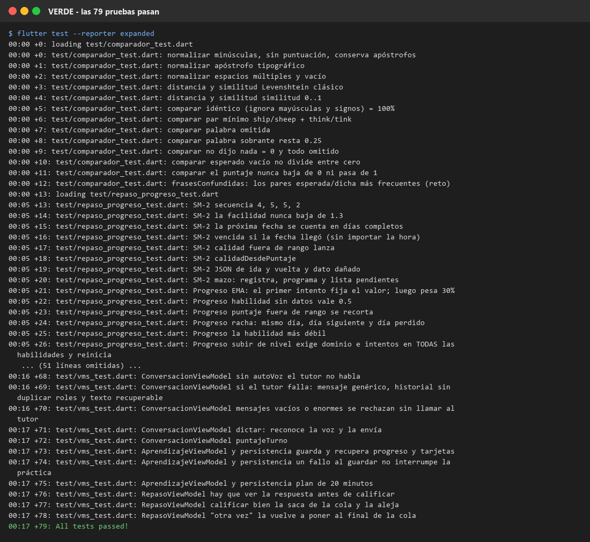

### 5. 📦 Compilación del APK

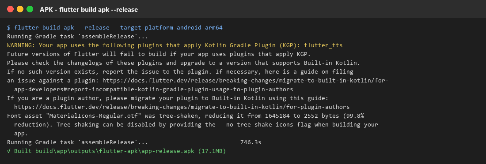

---

## ✅ Qué cubren las pruebas

| Grupo | Lo que se verifica |
|---|---|
| Comparador | normalizar (apóstrofo tipográfico), Levenshtein, similitud, ship/sheep + think/tink = 75%, omitida, sobrante, vacío, límites 0..1, frases confundidas |
| SM-2 | secuencia 4,5,5,2 → 1, 6, 16 y vuelta a 1; facilidad ≥ 1.3; días completos; JSON dañado |
| Progreso | EMA 30%, racha (mismo día, siguiente, perdido), más débil, subir de nivel exige todo |
| Plan diario | suma exacta (5, 10, 17, 20, 33 min), reparto concreto, refuerzo a la débil, ≥ 1 min |
| Tutor | la salida de la IA es entrada NO confiable, reglas del simulado, HTTPS obligatorio, recortes, 502, red, UTF-8 |
| ViewModels | silencio del micrófono, doble toque, errores sin detalles, lectura una vez, escritura, conversación que reintenta sin romper roles, persistencia, repaso |

```bash
flutter test
```

---

## 📱 Capturas de la app

> Tomadas en un teléfono físico con el APK instalado. *Guarda tus capturas en `capturas/` con estos nombres y aparecerán aquí automáticamente.*

| Plan del día | Pronunciación con colores | Dictado |
|---|---|---|
| 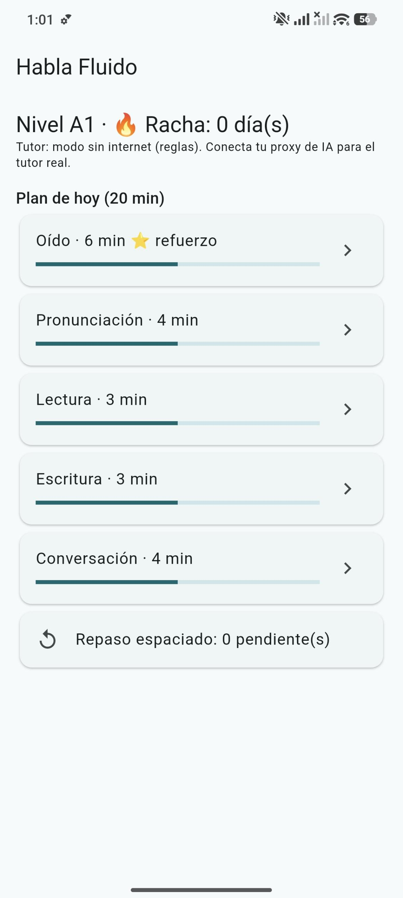 |  | 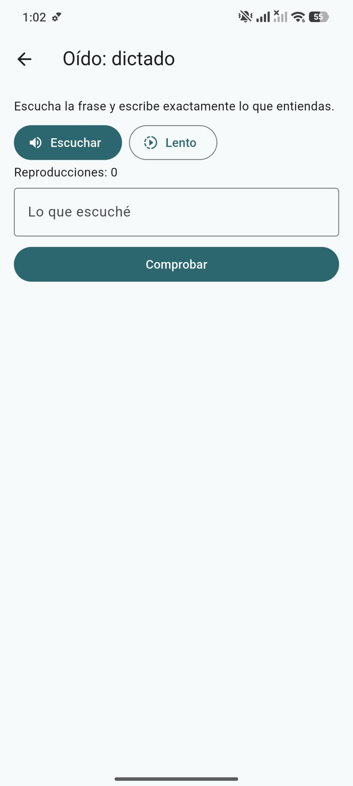 |

| Conversación con correcciones | Repaso espaciado | Error: sin permiso de micrófono |
|---|---|---|
| 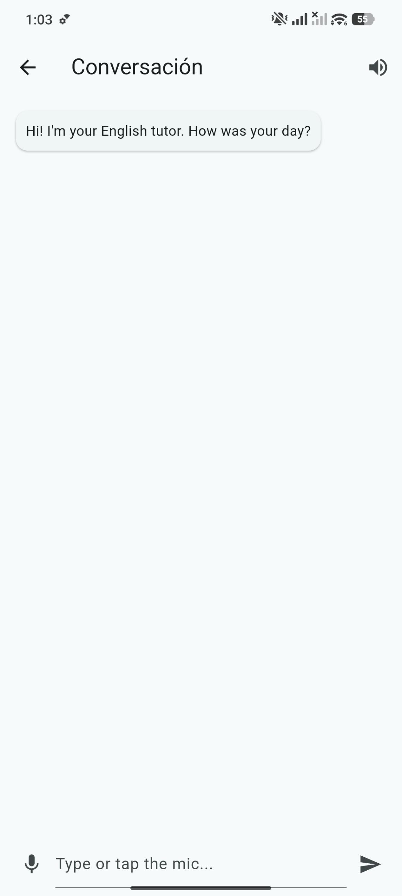 | 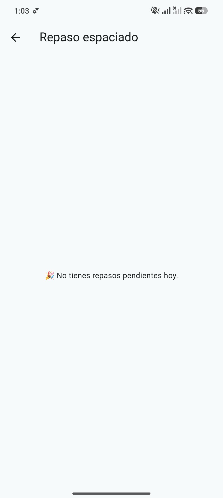 | 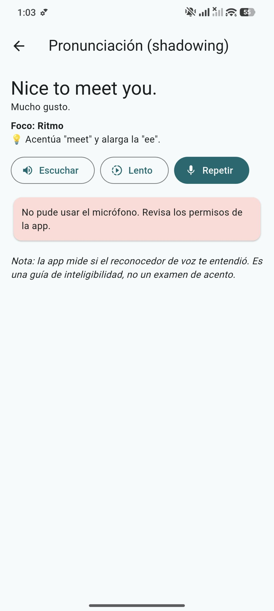 |

### Qué probar en la app

| Caso | Qué hacer | Resultado esperado |
|---|---|---|
| Pronunciación | Escuchar → Repetir y di la frase | Palabras en verde, naranja o rojo y % de puntaje |
| Dictado | Escuchar y escribe la frase | Puntaje y la frase pasa al repaso |
| Escritura | Escribe `He go to school every day` | Corrección "He go → He goes" |
| Conversación | Escribe `I am agree with you` | Corrección "I agree" y una pregunta para seguir |
| Silencio | Repetir sin hablar | "No te escuché. Acércate al micrófono…" |

---

## 🛠️ Cómo correr el proyecto

```bash
flutter pub get
```

```bash
flutter test
```

```bash
flutter run
```

